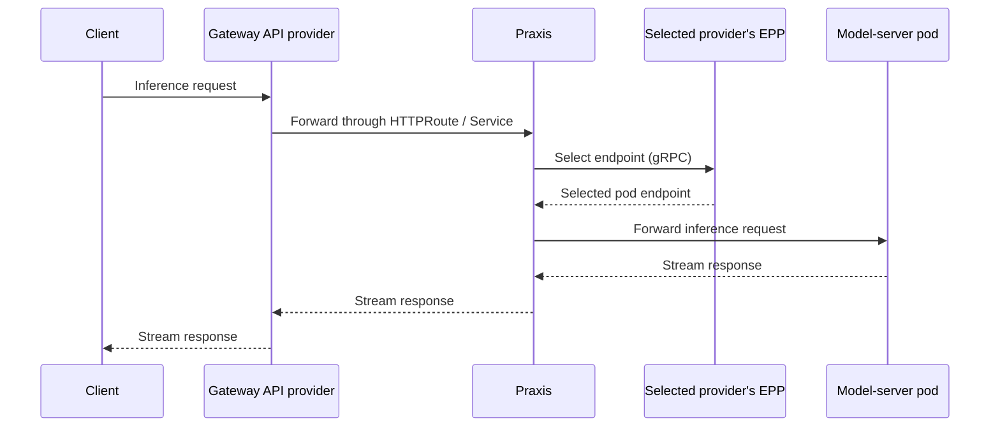

# Kserve Praxis Integration using any GWAPI provider

**Status:** proposal.

Use Praxis to serve KServe-hosted models behind the platform's chosen Gateway API provider. The gateway forwards requests to Praxis. Praxis parses, applies policy, chooses a model provider and asks KServe's endpoint picker (EPP) which model-server pod should handle the request.

**Scope note:** Praxis is likely to support Gateway API in the future. That would make a separate Gateway API Gateway backed by Praxis an additional option for KServe integration. This proposal focuses on using AI Gateway with KServe behind other Gateway API providers and does not depend on that future support.

## Expected user flows

A Gateway from the chosen GWAPI provider must already be available.

1. **Deploy AI Gateway**, creating the Praxis Deployment and Service.
2. **Create an LLMInferenceService** with an explicitly defined route attached to the chosen Gateway and targeting the deployed Praxis Service. Define the route through `spec.router.route.http.spec`, or reference an existing HTTPRoute through `spec.router.route.http.refs`.
3. **Create a ModelProvider** referencing that LLMInferenceService.
4. **Create a Model** that publishes the model name and maps it to the ModelProvider.
5. **Access the model through the Gateway route**, using the published model name.

### Canary / Weighted model serving
Flow is same as above flow except the user would Create two LLMInferenceServices and a ModelProvider for each. Publish one Model with weighted mappings to those ModelProviders.:

```yaml
 providers:
    - providerRef:
        name: assistant-stable
      upstreamModel: assistant
      weight: 90
    - providerRef:
        name: assistant-canary
      upstreamModel: assistant
      weight: 10
```

## Request path

```text
Client → Gateway → Praxis
                     ├─ 1. EPP call → endpoint returned to Praxis
                     └─ 2. Inference request → selected model-server pod
```

The EPP call is a gRPC network round trip. It returns the destination; Praxis then forwards inference directly to the selected pod, which KServe manages. **Model weights choose the provider and its pool. The EPP chooses a pod within that pool.**

## What needs to change

| Area | Required work |
| --- | --- |
| API | Let a ModelProvider reference an LLMInferenceService (possibly also InferencePool). Add relative weights to the Model's provider mappings. |
| [EPP filter](https://github.com/praxis-proxy/ai/blob/main/integrations/llmd/ext-proc/src/lib.rs) | Extend `ext_proc` with weighted EPP targets, one exchange per request and integration with model routing. |
| gateway-controller | Resolve each referenced service's pool/EPP and generate and deliver the corresponding Praxis configuration. |
| KServe integration | Agree how KServe recognises Praxis accepting an LLMInferenceService as a ModelProvider backend. |

The HTTPRoute points at the Praxis Service. Praxis handles the inference integration.

kServe requires that the Gateway provider writes a status condition to the InferencePool before marking the LLMInferenceService as ready. Integration and model service still works without this; but ideally the Praxis gateway-controller would also write a condition once the config has been accepted and written to praxis, but kServe would need to recognize this condition.

The proposed contract would be:

1. Praxis gateway-controller resolves the backend, configures its pool/EPP in Praxis, and writes its own pool-parent entry with Accepted=True.

```yaml
parentRef:
  group: aigateway.praxis.io
  kind: AIGateway
  name: praxis
  namespace: aigateway-system

```

2. KServe identifies the expected Praxis parent and checks its acceptance when evaluating InferencePoolReady.
3. KServe still owns overall LLMInferenceService readiness, combining that result with workload, EPP, ingress Gateway and route readiness.


## Initial delivery

Connect one Model to two LLMInferenceService-backed ModelProviders through controller-generated Praxis configuration. Changing their weights must update routing for new requests while existing streams continue.

Treat the KServe acceptance contract as a distinct integration item. 

AI Gateway route generation, automatic canary progression, cross-cluster discovery remain outside this delivery.

## Design details

### Resource relationships and ownership

A ModelProvider references the **LLMInferenceService**. gateway-controller resolves its InferencePool and EPP Service from the service's effective configuration and generated-resource relationships. Users do not need to track KServe's generated names.

| Owner | Responsibility |
| --- | --- |
| Platform operator / GWAPI provider | Maintain the Gateway; configure ingress TLS, timeouts and streaming behaviour. |
| KServe | Manage each LLMInferenceService, its workload, pool and EPP, and the HTTPRoute created from the user-defined route section. |
| Model owner | Publish the public Model name and assign provider weights. |
| Praxis control plane | Manage the Praxis Deployment/Service, reconcile backend references, deliver runtime configuration and report its own reconciliation status. |
| Praxis runtime | Apply configured policy, select one provider/EPP per request and proxy inference to the selected pod. |

### Request flow and rollout



Praxis resolves the public model name, selects a provider by weight and calls that provider's EPP. The provider and EPP choice stay fixed for the request, including its streamed response.

For a public Model named `assistant`:

| ModelProvider | Referenced LLMInferenceService | Relative weight |
| --- | --- | --- |
| stable | assistant-stable | 90 |
| canary | assistant-canary | 10 |

Both backends serve the identifier `assistant`.

Weight changes apply to new requests. Rollback changes the weights to stable-only while retaining the same ingress route.

These are proposed resource contracts; exact CRD fields still need API design.

### EPP filter improvements

The existing `ext_proc` filter supports a fixed EPP target. The proposal requires three improvements:

- **Weighted targets:** select an EPP from the providers configured for the requested model.
- **One EPP call per request:** remember when scheduling has completed so later filter stages do not call the EPP again.
- **Model routing integration:** choose the ModelProvider once per request, before calling its EPP, and retain that choice until the request finishes.

Retain the existing gRPC transport for EPP calls.

Full-duplex EPP body processing runs before normal request-phase upstream selection. The generated pipeline must establish the provider binding before the EPP exchange opens, without depending on a later load-balancer choice or making a second provider selection.

### Controller and failure behaviour

The controller must resolve the LLMInferenceService backend and its pool/EPP Service, compile model-specific provider bindings and deliver configuration updates to Praxis. Report the resolved backend and configuration outcome on Praxis-owned status.

For the first implementation, zero weight disables a mapping; no enabled mappings rejects requests. A selected EPP failure returns 503. Support `FailClose` initially.

### KServe setup

Use KServe's managed scheduler/pool configuration. Supplying `router.scheduler.pool.ref` instead selects an externally managed pool and EPP.

Reference the existing Gateway through `router.gateway.refs`. Define the HTTPRoute in `router.route.http.spec`, with the chosen Gateway as its parent and the deployed Praxis Service as its backend. The user supplies this route section on the LLMInferenceService; KServe creates and reconciles the HTTPRoute from it. [KServe configuration reference](https://kserve.github.io/website/docs/model-serving/generative-inference/llmisvc/llmisvc-configuration).

Praxis must be able to reach the EPP Services and returned model Pod IPs.

### Acceptance and KServe readiness

The proposed direction is for gateway-controller to accept the LLMInferenceService as a backend consumed by ModelProvider and report whether Praxis can be configured to use it. Ingress acceptance remains with the selected GWAPI provider, whose HTTPRoute references the Praxis Service.

KServe 0.21 expects pool acceptance associated with the relevant Gateway. An ingress route to the Praxis Service does not establish that pool attachment. KServe can therefore report `Ready=False` and `InferencePoolReady=False`, reason `WaitingForGateway`, while the workloads and EPP are available. [KServe readiness implementation](https://github.com/kserve/kserve/blob/v0.21.0/pkg/controller/v1alpha2/llmisvc/router.go).

ModelProvider acceptance alone does not satisfy that check. How KServe recognises the Praxis backend relationship remains open and may require a KServe change. 

### Portability and trade-offs

The portability boundary is standard [HTTPRoute-to-Service routing](https://gateway-api.sigs.k8s.io/reference/api-types/httproute/). The ingress provider needs no inference extension or provider-specific EPP filter. It must support the required HTTP and streaming behaviour; buffering, timeout and TLS defaults can differ.

Routing ingress directly to an InferencePool would require the ingress provider's inference integration and bypass Praxis's serving path. Requiring Praxis to supply ingress would constrain provider choice. Keeping Praxis behind a Service preserves that choice, at the cost of an additional HTTP proxy hop and a per-request EPP callout. 

Path-based model routing is not automatically preserved when an HTTPRoute targets a shared Praxis Service. Without implementing Gateway API in Praxis, preserving it requires an explicit handoff from ingress. 
- One possible workaround is for the HTTPRoute to use `RequestHeaderModifier.set` to supply `x-ai-gateway-model-published-name`, containing the Model's published name. The Gateway provider retains path matching, rewriting and route status ownership.
The Gateway-Controller would watch routes targeting its managed Praxis Services, validate the Model binding and generate header-based model selection and filter conditions.
